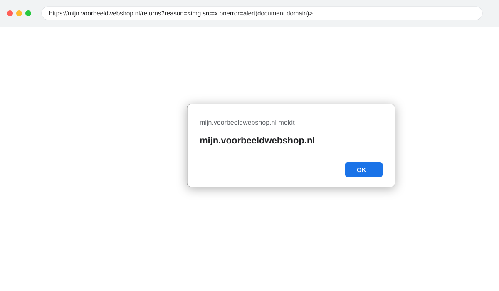

## Geen rate limiting op API en inlogformulier

**Severity**: Medium · **CVSS 3.1**: 5.3 (`CVSS:3.1/AV:N/AC:L/PR:N/UI:N/S:U/C:L/I:N/A:N`) · **Status**: Confirmed · **Source**: Burp Suite · **Mapping**: A07:2021, WSTG-ATHN-03, API4:2023 · **CWE**: 307

**Affected**:

- https://api.voorbeeldwebshop.nl/v2/auth/login
- https://api.voorbeeldwebshop.nl/v2/orders/{id}
- https://mijn.voorbeeldwebshop.nl/login

### Description

Er is geen beperking op het aantal verzoeken per account of IP-adres. Tijdens de test zijn 2.000 inlogpogingen in 40 seconden uitgevoerd zonder vertraging, blokkade of CAPTCHA. Ook de API-endpoints kennen geen limiet, wat het massaal uitlezen van orders (F-01) vergemakkelijkt.

### Impact

Wachtwoorden kunnen via credential stuffing of brute force worden geraden. In combinatie met de voorspelbare ordernummers maakt dit het geautomatiseerd leeghalen van de API triviaal.

### Evidence

```
$ ffuf -w passwords.txt -u https://api.voorbeeldwebshop.nl/v2/auth/login -X POST -H "Content-Type: application/json" -d '{"email":"tester1@example.org","password":"FUZZ"}' -mc 200,401 -t 50
...
:: Progress: [2000/2000] :: Job [1/1] :: 50 req/sec :: Duration: [0:00:40] :: Errors: 0 ::
```

Alle 2.000 verzoeken kregen een inhoudelijk antwoord (HTTP 401); het account werd niet vergrendeld.

### Recommendation

- Beperk inlogpogingen per account (bijv. 5 per 15 minuten) en per IP-adres, met een oplopende vertraging en logging van overschrijdingen.
- Pas rate limiting toe op alle API-endpoints op basis van API-token en IP-adres (bijv. 60 verzoeken per minuut per gebruiker).
- Overweeg monitoring op afwijkende patronen (veel verschillende order-ID's vanaf één account).

### References

- OWASP Authentication Cheat Sheet, Login Throttling: https://cheatsheetseries.owasp.org/cheatsheets/Authentication_Cheat_Sheet.html

## Reflected cross-site scripting in de retourpagina

**Severity**: Medium · **CVSS 3.1**: 6.1 (`CVSS:3.1/AV:N/AC:L/PR:N/UI:R/S:C/C:L/I:L/A:N`) · **Status**: Confirmed · **Source**: Burp Suite · **Mapping**: A03:2021, WSTG-INPV-01 · **CWE**: 79

**Affected**:

- https://mijn.voorbeeldwebshop.nl/returns?reason=

### Description

De parameter `reason` wordt zonder encoding teruggegeven in de HTML van de retourpagina. Een aanvaller kan een link construeren die bij het openen JavaScript uitvoert in de context van het klantportaal.

### Impact

Bij het aanklikken van een geprepareerde link (bijvoorbeeld in een phishingmail) kan een aanvaller handelingen uitvoeren namens het slachtoffer, zoals het wijzigen van het afleveradres of het opvragen van ordergegevens. Het sessiecookie zelf is `HttpOnly` en kan niet worden gestolen; de impact is daarmee beperkt tot de duur van de sessie.

### Evidence

```
https://mijn.voorbeeldwebshop.nl/returns?reason=%3Cimg%20src%3Dx%20onerror%3Dalert(document.domain)%3E
```



### Recommendation

- Pas contextafhankelijke output-encoding toe op alle gebruikersinvoer die in HTML wordt opgenomen (de gebruikte template-engine biedt dit standaard; de `| safe`-filter op deze pagina moet worden verwijderd).
- Voer een Content Security Policy in zonder `unsafe-inline` als extra verdedigingslaag.

### References

- OWASP XSS Prevention Cheat Sheet: https://cheatsheetseries.owasp.org/cheatsheets/Cross_Site_Scripting_Prevention_Cheat_Sheet.html

## Ontbrekende beveiligingsheaders

**Severity**: Low · **CVSS 3.1**: 3.1 (`CVSS:3.1/AV:N/AC:H/PR:N/UI:R/S:U/C:L/I:N/A:N`) · **Status**: Confirmed · **Source**: Nuclei · **Mapping**: A05:2021, WSTG-CONF-12 · **CWE**: 693

**Affected**:

- https://shop.voorbeeldwebshop.nl
- https://mijn.voorbeeldwebshop.nl

### Description

De applicaties sturen geen `Content-Security-Policy`, `X-Frame-Options` of `Referrer-Policy` header. `Strict-Transport-Security` is wel aanwezig, maar met een korte `max-age` van 300 seconden en zonder `includeSubDomains`.

### Impact

Het ontbreken van deze headers maakt andere aanvallen (zoals de XSS in F-04 en clickjacking) makkelijker en effectiever. Op zichzelf vormt het geen direct risico.

### Evidence

```
$ curl -sI https://shop.voorbeeldwebshop.nl/ | grep -iE "content-security|x-frame|referrer|strict-transport"
Strict-Transport-Security: max-age=300
```

### Recommendation

- Stel een Content Security Policy in (begin met `default-src 'self'` en breid gericht uit), `X-Frame-Options: DENY` of `frame-ancestors 'none'`, en `Referrer-Policy: strict-origin-when-cross-origin`.
- Verhoog `max-age` van HSTS naar minimaal één jaar en voeg `includeSubDomains` toe; overweeg opname in de preload-lijst.

### References

- OWASP HTTP Headers Cheat Sheet: https://cheatsheetseries.owasp.org/cheatsheets/HTTP_Headers_Cheat_Sheet.html

## Gedetailleerde foutmeldingen op de API

**Severity**: Low · **CVSS 3.1**: 3.7 (`CVSS:3.1/AV:N/AC:H/PR:N/UI:N/S:U/C:L/I:N/A:N`) · **Status**: Confirmed · **Source**: Burp Suite · **Mapping**: A05:2021, WSTG-ERRH-02 · **CWE**: 209

**Affected**:

- https://api.voorbeeldwebshop.nl/v2/*

### Description

Bij ongeldige invoer geeft de API een volledige stacktrace terug, inclusief interne paden (`/srv/shop-api/app/controllers/orders.py`), frameworkversies en de naam van de databaseserver (`db-prod-01.internal`).

### Impact

De informatie helpt een aanvaller bij het voorbereiden van gerichte aanvallen; zo werd de PostgreSQL-versie uit F-02 hier bevestigd.

### Evidence

```json
{
  "error": "ValueError: invalid literal for int() with base 10: 'abc'",
  "traceback": [
    "File \"/srv/shop-api/app/controllers/orders.py\", line 88, in get_order",
    "File \"/srv/shop-api/venv/lib/python3.11/site-packages/sqlalchemy/engine/base.py\", line 1412, in execute"
  ],
  "db": "db-prod-01.internal:5432"
}
```

### Recommendation

- Schakel debug-foutmeldingen uit op acceptatie en productie en geef een generieke foutmelding met een correlatie-ID terug; log de details server-side.

### References

- OWASP Error Handling Cheat Sheet: https://cheatsheetseries.owasp.org/cheatsheets/Error_Handling_Cheat_Sheet.html

## Directory listing op de static-server

**Severity**: Info · **CVSS 3.1**: 0.0 (`CVSS:3.1/AV:N/AC:L/PR:N/UI:N/S:U/C:N/I:N/A:N`) · **Status**: Confirmed · **Source**: ffuf · **Mapping**: A05:2021, WSTG-CONF-04 · **CWE**: 548

**Affected**:

- https://static.voorbeeldwebshop.nl/assets/

### Description

De map `/assets/` toont een directory listing. Er zijn alleen publieke afbeeldingen en stylesheets aangetroffen; geen gevoelige bestanden.

### Impact

Geen direct risico. Een listing maakt het wel makkelijker om per ongeluk geplaatste bestanden (back-ups, exports) te vinden.

### Evidence

```
$ curl -s https://static.voorbeeldwebshop.nl/assets/ | grep -c "<a href"
214
```

### Recommendation

- Schakel directory listing uit (`Options -Indexes`).

### References

- WSTG-CONF-04: https://owasp.org/www-project-web-security-testing-guide/v42/4-Web_Application_Security_Testing/02-Configuration_and_Deployment_Management_Testing/04-Review_Old_Backup_and_Unreferenced_Files_for_Sensitive_Information
